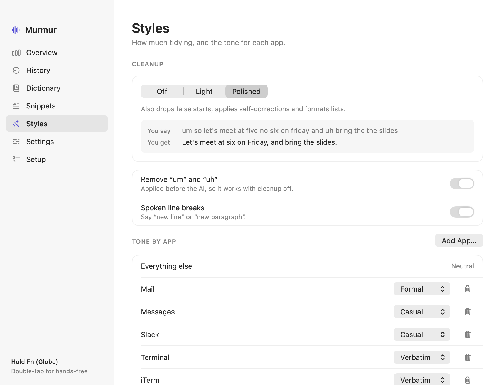

# Murmur

Hold a key, talk, let go. Murmur transcribes on your Mac, tidies the result with an
on-device language model, and types it into whatever app you're using.

Free, open source, and private by default: no account, no telemetry, and your audio
never leaves the machine.


| | |
|---|---|
|  |  |

## What it does

- **Push to talk.** Hold Fn (or Right ⌥ / ⌘ / ⌃), speak, release. Double-tap for hands-free. Esc cancels.
- **Whisper large-v3-turbo**, run locally through [whisper.cpp](https://github.com/ggml-org/whisper.cpp) with Metal.
- **AI cleanup.** Removes fillers and false starts, applies self-corrections ("at three, no wait, four" → "at four"),
  formats lists. Uses Apple's on-device model; optionally your own Anthropic, OpenAI or Groq key (text only).
- **Tone per app.** Formal in Mail, casual in Messages, verbatim in terminals and editors.
- **Dictionary and snippets.** Teach it names and jargon; say "my email" and get the address.
- **History and stats.** Searchable, stored as plain JSON on your Mac, with a retention setting.

## Light by design

One native process. No Python, no ffmpeg, no local server, no Electron.

| Measured on an M4 MacBook, macOS 27 | |
|---|---|
| App bundle | 7.6 MB |
| Idle memory | 11 MB |
| Idle CPU / wake-ups | 0.0 % / 0 per second |
| 9 s of speech → text (model warm) | about 1.4 s |
| On-device cleanup | about 1 s |

The speech model is loaded when you press the key and released after five idle minutes
(configurable), so it costs memory only while you're dictating.

## Install

Requires macOS 14 or later on Apple Silicon. On-device cleanup needs macOS 26 with Apple Intelligence
turned on; without it Murmur still transcribes and applies its rule-based cleanup.

```bash
brew install cmake
git clone https://github.com/YOUR_NAME/murmur && cd murmur
./build.sh --install
```

Open Murmur from Applications. Setup asks for two permissions and downloads the model (574 MB, once):

- **Microphone**, to hear you.
- **Accessibility**, to notice the dictation key and paste the result.

If you use Fn, set *System Settings › Keyboard › Press 🌐 key to* **Do Nothing**.

Builds are ad-hoc signed, so macOS treats each rebuild as a new app and asks for the permissions again.
Set `SIGN_ID` to a signing identity when running `build.sh` to avoid that.

## Privacy

- Audio is held in memory while you speak and discarded after transcription. Nothing is written to disk.
- Network is used for exactly two things: downloading a model you choose, and, only if you paste an API key
  and select a cloud engine, sending the transcript text for cleanup.
- API keys are stored in the Keychain. History lives in `~/Library/Application Support/Murmur/`.

## Development

```bash
./build.sh                                              # build + run checks
.build/release/MurmurCheck                              # text rules, cleanup guard, stats
.build/release/Murmur --transcribe clip.wav --cleanup polished   # speech path, no mic needed
.build/release/Murmur --render-screens out/             # every screen as PNG, light and dark
```

`PROJECT_PROMPT.md` describes the product and its interface in full.

## License

MIT. whisper.cpp is MIT; Whisper model weights are released by OpenAI under MIT.
