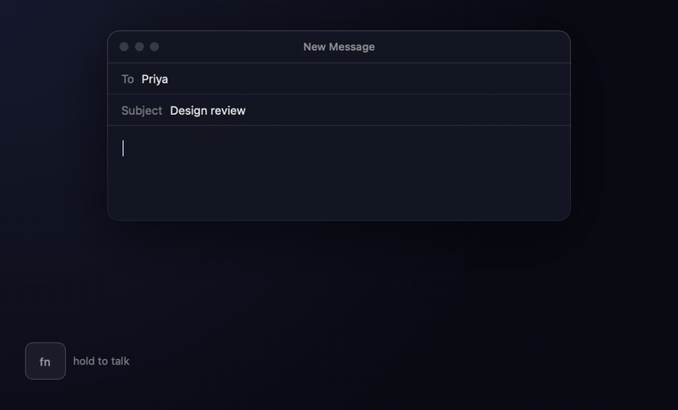
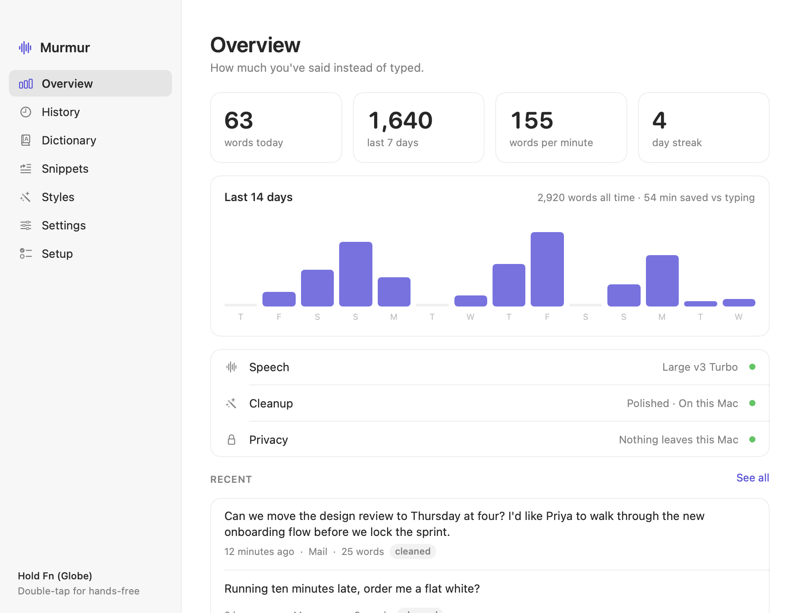
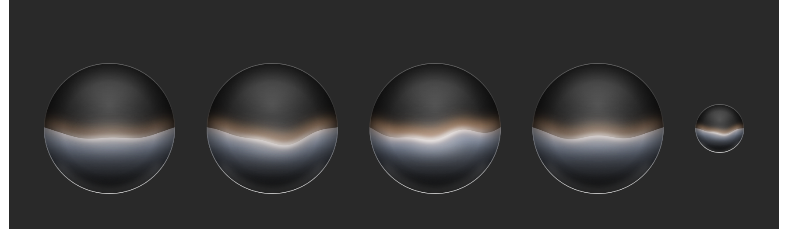
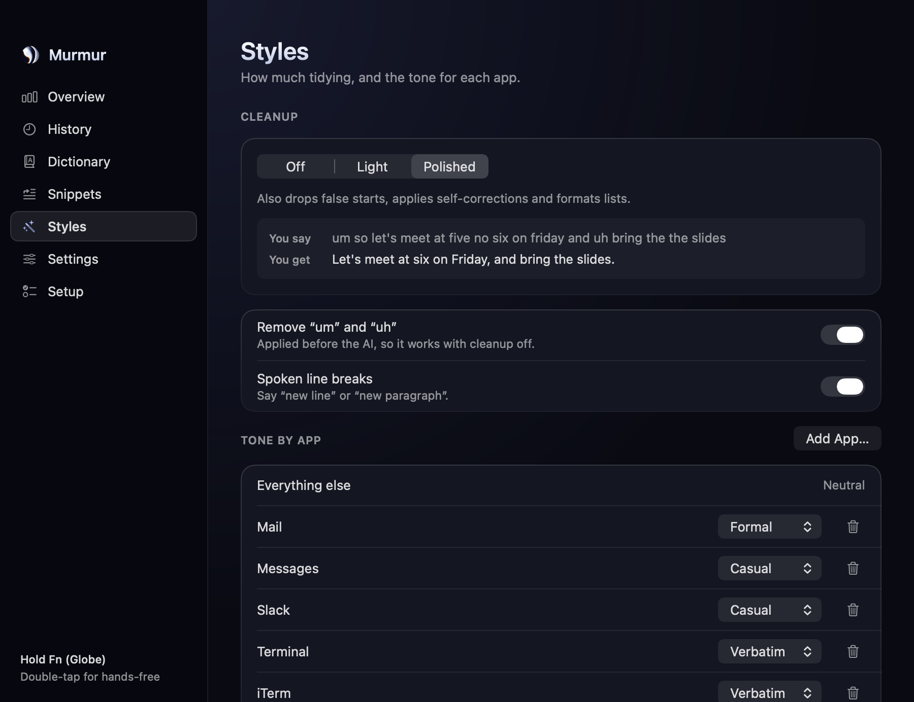

# Murmur

Hold a key, talk, let go. Murmur transcribes on your Mac, tidies the result with an
on-device language model, and types it into whatever app you're using.

**[See it in action at cryptochefa.github.io/murmur](https://cryptochefa.github.io/murmur/)**

Free, open source, and private by default: no account, no telemetry, and your audio
never leaves the machine.





| | |
|---|---|
|  |  |

## What it does

- **Push to talk.** Hold Fn (or Right ⌥ / ⌘ / ⌃), speak, release. Double-tap for hands-free. Esc cancels.
- **Whisper large-v3-turbo**, run locally through [whisper.cpp](https://github.com/ggml-org/whisper.cpp) with Metal.
- **AI cleanup.** Removes fillers and false starts, applies self-corrections ("at three, no wait, four" → "at four"),
  formats lists. Uses Apple's on-device model; optionally your own Anthropic, OpenAI or Groq key (text only).
- **Tone per app.** Formal in Mail, casual in Messages, verbatim in terminals and editors.
- **Dictionary and snippets.** Teach it names and jargon; say "my email" and get the address.
- **Edit by voice.** Select text, hold a second key (Right ⌥ by default), and say how to change it.
- **Names on screen.** Reads the text box you're typing in so names already there are spelled the same way.
- **Learns from corrections.** Fix a word Murmur typed and it offers the fix as a dictionary entry.
- **Whisper mode** for very quiet speech, and words shown under the orb as each phrase is transcribed.
- **Shortcuts.** ⌃⌥V pastes the last dictation again, ⌃⌥Z undoes it.
- **Updates itself.** Checks GitHub once a day and, when you click Update, pulls the source and rebuilds.
- **Two orbs, five colours.** Mercury, liquid chrome that slides into a pill, or Halftone, a globe of dots with its status underneath.
- **History and stats.** Searchable, stored as plain JSON on your Mac, with a retention setting.

## Light by design

One native process. No Python, no ffmpeg, no local server, no Electron.

| Measured on an M4 MacBook, macOS 27 | |
|---|---|
| App bundle | 7.6 MB |
| Memory at launch / between dictations | 12 MB / about 50 MB |
| Loading the speech model | about 0.25 s, while you talk |
| Idle CPU / wake-ups | 0.0 % / 0 per second |
| 2 s sentence → text (model warm) | about 0.5 s |
| 9 s of speech → text | about 0.8 s |
| On-device cleanup, when needed | about 1 s |

Three things keep it quick: Whisper's audio window is sized to what you actually said instead of a fixed
30 seconds; the cleanup model is skipped when the transcript is already clean; and during long dictations each
phrase is transcribed at the pause after it, so only the last one is left when you let go.

The speech model loads when you press the key, in about a quarter of a second, while you're already
talking. It is released as soon as the dictation ends, so between dictations Murmur holds about 50 MB.
Settings can keep it loaded longer if you prefer.

## Install

Requires macOS 14 or later on Apple Silicon. On-device cleanup needs macOS 26 with Apple Intelligence
turned on; without it Murmur still transcribes and applies its rule-based cleanup.

```bash
brew install cmake
git clone https://github.com/CryptoChefA/murmur && cd murmur
./build.sh --install
```

Open Murmur from Applications. Setup asks for two permissions and downloads the model (574 MB, once):

- **Microphone**, to hear you.
- **Accessibility**, to notice the dictation key and paste the result.

If you use Fn, set *System Settings › Keyboard › Press 🌐 key to* **Do Nothing**.

### Signing

macOS ties permissions to an app's signature, and macOS 27 does not honour Accessibility for ad-hoc signed
apps at all. So the first `./build.sh` creates a self-signed certificate named "Murmur Local Signing" in your
login keychain and signs the app with it. It is used for nothing else, and your permissions then survive
rebuilds. macOS may ask once whether `codesign` can use the key.

To sign with your own identity, run `SIGN_ID="Developer ID Application: …" ./build.sh`. To skip signing
identities altogether, use `SIGN_ID=-` (the dictation key and pasting will not work on macOS 27).

### Scripting

`Murmur --toggle` starts or finishes a dictation in the running app, for launchers and shortcuts.

## Privacy

- Audio is held in memory while you speak and discarded after transcription. Nothing is written to disk.
- Network is used for exactly three things: downloading a model you choose; one request a day to GitHub to see
  whether a newer version exists (switch it off in Settings); and, only if you paste an API key and select a
  cloud engine, sending the transcript text for cleanup.
- "Names on screen" and "Learn from corrections" read the text box you are typing in, through the Accessibility
  permission. That text stays in memory on your Mac, is never saved, and is never sent to a cloud engine.
  Both can be switched off.
- API keys are stored in the Keychain. History lives in `~/Library/Application Support/Murmur/`.

## Development

```bash
./build.sh                                              # build + run checks
.build/release/MurmurCheck                              # text rules, cleanup guard, stats
.build/release/Murmur --transcribe clip.wav --cleanup polished   # speech path, no mic needed
.build/release/Murmur --render-screens out/             # every screen as PNG
.build/release/Murmur --render-demo frames/             # the README animation, frame by frame
.build/release/Murmur --bench-load                      # model load time and memory before and after
```

`PROJECT_PROMPT.md` describes the product and its interface in full.

## License

MIT. whisper.cpp is MIT; Whisper model weights are released by OpenAI under MIT.
